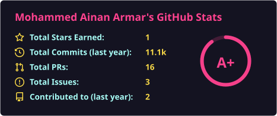

### About Me

- **Full-Stack Engineer & Automation Architect**
- Passionate about **Distributed Systems, Cloud Infrastructure & Automation**
- I build **production web applications and scalable event-driven systems** using React, Next.js, TypeScript, Node.js & Python
- Specializing in **24/7 background daemons, browser automation (Playwright), and self-healing pipelines**
- Cloud deployments across **Google Cloud Platform (GCP), Docker, AWS, Vercel & Linux**
- Turning ideas into **real, shipped products** — from microservices to full-stack SaaS
- Currently leveling up in **System Design, High-Performance Computing & Distributed Architectures**
- Reach me at **[mohammedainan3@gmail.com](mailto:mohammedainan3@gmail.com)**

 

### Tech Stack

 

 

 

 

 

 

 

### Featured Projects

| Project | Stack | Highlights |
|---|---|---|
| **[XAutomation](https://github.com/ainan-codes/xautomation)** | TypeScript · Docker · GCP · Node.js · Playwright · FFmpeg | 24/7 autonomous social media intelligence & multi-account scheduling engine with 4K faststart media transcoding |
| **DevForge Platform** | React · Node.js · Express · Distributed Services | Autonomous developer workflow and continuous release automation platform |
| **Symptomwise Health** | Next.js · TypeScript · Tailwind · PostgreSQL | Clinical diagnostic reasoning platform with differential triage and automated pathology analytics |
| **Reels Automation Hub** | Python · Faststart · FFmpeg · Cloud Storage | Automated short-form media curation, dynamic audio transcoding, and scheduled multi-platform publishing |
| **GradeFlow** | React · Node.js · PostgreSQL · Prisma | Modern educational workflow automation and grading analytics system with granular audit trails |

👉 Explore more on my [repositories page](https://github.com/ainan-codes?tab=repositories)

 

### GitHub Stats

 

### Connect with Me

 

